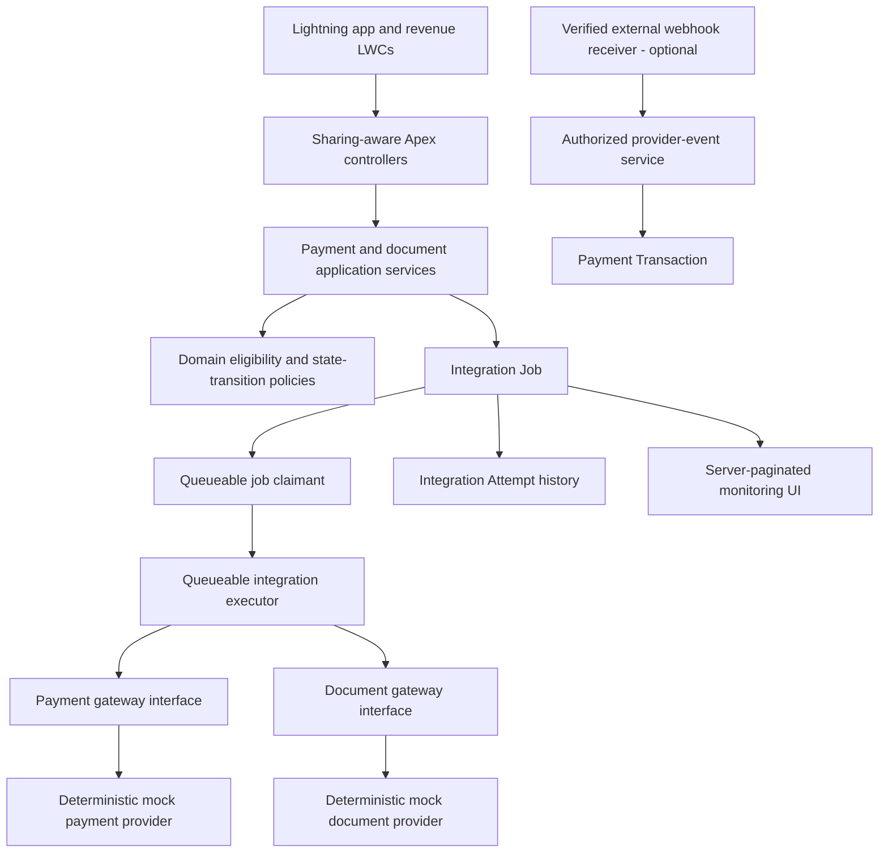

# Architecture

## Scope and environment

This project uses standard Salesforce revenue objects and adds only the lifecycle and integration records needed by the portfolio application. The target development org is a single-currency Developer Edition org with `Quote` and `QuoteLineItem` enabled.

The source API version is 68.0. Foundation metadata passed offline source conversion and XML parsing. The application slice includes permission-gated request services, mock gateways, queueable processing, a monitoring/retry controller, a Quote-selection workspace, and Apex/Jest tests. It is deployed to the non-production `practice-org-1` org; all 21 selected Apex tests and all 3 LWC Jest tests pass. No provider credentials or real external provider calls are configured.

## Application boundaries

User-facing controllers enforce record access, CRUD/FLS, and custom permissions. Services own the business use cases; domain policies own eligibility and state transitions. Gateways own provider transport and response parsing. Queueable workers own asynchronous callouts. The org's retry dispatcher runs hourly and processes at most one due job per execution.

The asynchronous worker updates only the validated transaction and job records it was assigned. Provider secrets never enter source control or custom metadata. Optional real providers use Named Credentials and External Credentials. A real payment webhook requires a separately authenticated external receiver that verifies signatures and replay protections before forwarding events to Salesforce.

## Declarative automation

Use the standard Salesforce approval process on Quote rather than a parallel custom approval state machine. Core payment/document orchestration, state changes, and retries remain in Apex because they require idempotency, async callouts, and controlled error handling.

An after-save Flow may notify integration operators when a job first enters Dead Letter. It must not update the job or duplicate Apex-owned state transitions.

## Security boundaries

Controllers use explicit sharing behavior and user-mode access checks where suitable. Privileged actions additionally check a custom permission. Async system-context operations are narrowly scoped to persisted, authorized jobs; UI callers cannot supply authoritative payment amounts or statuses. Integration errors are sanitized before persistence.

## Delivery stages

1. Foundation metadata and documentation (complete and deployed).
2. Payment/document services, mock gateways, retry scheduling, and Apex tests (complete and deployed).
3. Lightning workspace and Jest tests (complete and deployed).
4. Optional real provider adapters, only after provider configuration is separately approved.
5. Operational notifications, CI, and deployment automation remain future enhancements.

The retry dispatcher is implemented with 1/2/4-minute exponential delays, capped at one hour, and a three-attempt maximum. Its owner-approved schedule runs hourly and handles one due job per run; additional due jobs wait for the next hour. This conservative baseline should be revisited before production-scale volumes.
